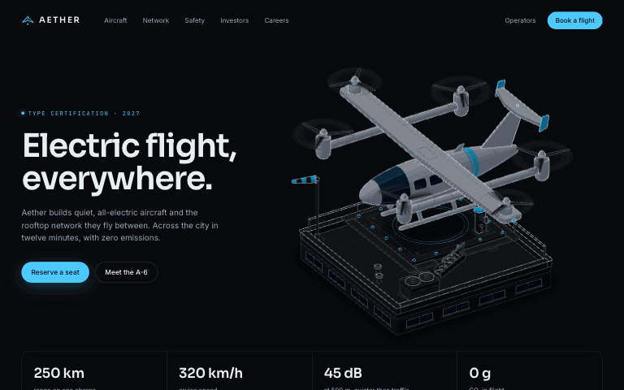

# Teddarific / skills

A collection of [Agent Skills](https://agentskills.io) for Claude Code, OpenCode, Codex and Antigravity. Each skill is a folder under [`skills/`](skills) with a `SKILL.md` at its root.

## Skills

| Skill | What it does |
|---|---|
| [`anatomy-asset`](skills/anatomy-asset) | Crafted, highly detailed isometric SVG illustrations for landing pages, product sites, launch posts and decks: real objects built from many small solid parts, mostly monochrome with brand accents, animated in CSS so they move even as a plain ``. A fork of [Anatomy](https://github.com/wheresryan22/anatomy) by Ryan. [Examples gallery](https://www.magicpatterns.com/os/1FyiDKAoDWYp6DEW1jQmgz/eH9fNzakc7ftmL5BkLgqfK) · [Aether landing page](https://www.magicpatterns.com/os/1FyiDKAoDWYp6DEW1jQmgz/vn1wkBo1A85rreFiefjVjU) · [Halden landing page](https://www.magicpatterns.com/os/1FyiDKAoDWYp6DEW1jQmgz/nGo5msWtXZqk2hN925WC4b) |

<p align="center">
  
</p>

## Install

With the [`skills`](https://github.com/vercel-labs/skills) CLI, pick a skill by name:

```sh
npx skills add Teddarific/skills --skill anatomy-asset -g -a claude-code
```

`-g` installs for your user; leave it off to install into the current project. `--skill '*'` installs every skill here. Swap the agent with `-a opencode`, `-a codex` or `-a antigravity`.

Or clone the collection and link the skills you want:

```sh
git clone https://github.com/Teddarific/skills.git ~/teddarific-skills
ln -s ~/teddarific-skills/skills/anatomy-asset ~/.claude/skills/anatomy-asset
```

## Adding a skill

Create `skills/<name>/SKILL.md` with `name` and `description` frontmatter; everything else the skill needs (references, scripts, examples) lives in the same folder. Give it a job in `.github/workflows/ci.yml` with `working-directory: skills/<name>` if it has tests or builds.

## License

Each skill carries its own license in its folder. `anatomy-asset` is MIT, as is the Anatomy skill it is forked from.
